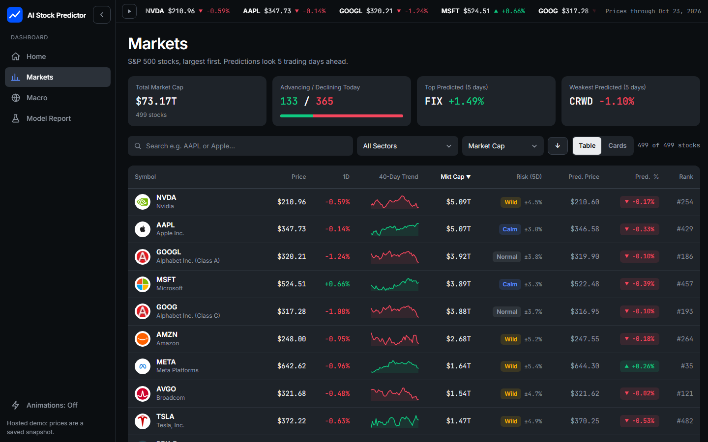

<div align="center">

# AI Stock Predictor

**Rank the whole S&P 500. Know how far to trust it.**

A free, open-source stock dashboard that scores every S&P 500 company, forecasts how risky each one is, and then grades its own predictions against a simple baseline, so you see the signal and the honesty together.

<a href="https://ai-stock-predictor-nuj6.onrender.com/"></a>

<sub>The demo runs on a free server and sleeps when idle, so the first load can take up to a minute.</sub>

<br>



</div>

> **Experimental. Not financial advice.** The return forecast has no reliable edge over simply guessing "up", and the app says so on screen. The risk forecast does beat its baseline. See [Results](#results).

## Features

- **Markets**: the full watchlist sorted by market cap, with company logos, 40-day sparklines, a 5-day return estimate and a Calm / Normal / Wild risk rating. Search, filter by sector, sort, and switch between table and card layouts.
- **Stock page**: candlestick or line chart with the predicted price, a typical-swing range, moving averages, 52-week range and key figures.
- **Macro**: interest rates, yields and spreads from FRED.
- **Model report**: hit rate, weekly top-versus-bottom spread, rank correlation and risk-forecast accuracy, all measured on two years of data the model never saw.
- **Free and local**: no paid APIs, no account, no API key. Run on your own machine, the server listens on `127.0.0.1` only.

## Run it yourself

Requires Python 3.11 or newer.

```bash
pip install -r requirements.txt
python server.py
```

The browser opens at <http://127.0.0.1:8000>. The repository includes a saved snapshot of prices and a trained model, so it works immediately. To pull fresh data, choose **Update Data & Retrain** in the sidebar. This downloads about ten years of prices, share counts, logos and FRED series, then retrains both models. The first update takes a few minutes.

Run the sanity tests (feature columns, RSI bounds, no look-ahead):

```bash
python test_model.py
```

When the `PORT` environment variable is set (as on most hosting services), the server listens publicly in read-only mode: the Update button is hidden and `POST /api/update` returns 403. Set `ALLOW_UPDATE=1` to turn updating back on.

## How it works

| Step | What happens |
| --- | --- |
| Data | Prices from Yahoo Finance via `yfinance`, the S&P 500 list from Wikipedia, macro series from FRED's public CSV endpoint. |
| Features | 20 numbers per stock per day: momentum, trend, volatility, strength versus peers, and the rate backdrop. |
| Return model | One pooled Ridge regression for all stocks, predicting the 5-day return. |
| Risk model | A HAR-style Ridge regression on log volatility, predicting next-week realized volatility. |
| Scoring | Time-ordered two-year holdout. Each week the top fifth of stocks is compared with the bottom fifth, using non-overlapping weeks and a t-statistic. A model only counts as having an edge if the spread is positive and t > 2. |

## Results

Measured on two held-out years for the model snapshot included in this repository (your numbers will vary with the data you download):

| | Model | Baseline |
| --- | --- | --- |
| **Return forecast**: hit rate | 52.4% | 52.3% (always guess up) |
| **Risk forecast**: share of next-week volatility explained | 23.2% | 18.5% ("same as lately") |

The return forecast is reported as **No Reliable Signal** (weekly spread t-statistic about 0). The risk forecast separates stocks clearly: the Calm, Normal and Wild groups moved 1.3%, 1.7% and 2.6% a day on average.

## Project layout

```
server.py        FastAPI app and update job (run this)
engine.py        data download, features, models, scoring, predictions
test_model.py    feature and look-ahead checks
static/          web interface (HTML, CSS, JavaScript, fonts, tech logos)
data/, model/    saved prices and trained model (the snapshot)
docs/            screenshot, presentation (.pptx) and brochure (.pdf)
```

## Technology

Python, FastAPI, Uvicorn, pandas, NumPy, scikit-learn, joblib, yfinance, requests, lxml and FRED. The front end is plain JavaScript with canvas and SVG charts and Inter and JetBrains Mono fonts bundled locally. Logos in `static/tech/` come from [Simple Icons](https://simpleicons.org) (CC0) plus a few drawn for this project.

## Data and attribution

Prices are daily closes from Yahoo Finance, macro data is from FRED (St. Louis Fed), company logos are public favicons cached locally. Check each provider's terms before using the data beyond personal use.

## License

[MIT](LICENSE) © 2026 Manomay Milind Kini
